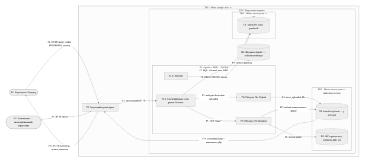
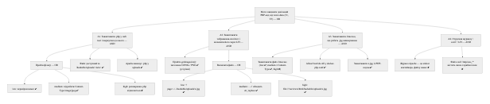
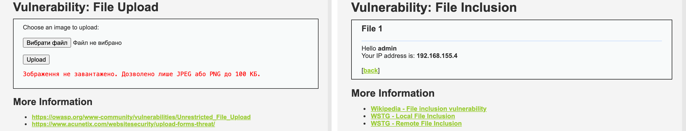
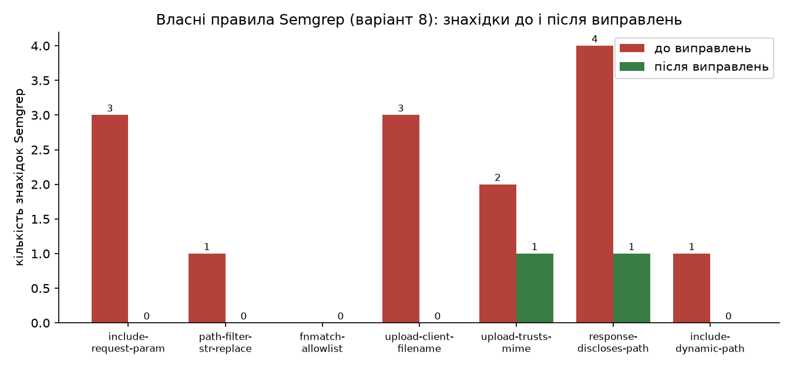

<!-- Звіт про РГР. Збирається в HTML/PDF скриптом report/tools/build_report.py (ДСТУ 3008:2015). -->

::: titlepage
Національний технічний університет України <br>
«Київський політехнічний інститут імені Ігоря Сікорського»

Факультет інформатики та обчислювальної техніки <br>
Кафедра інформатики та програмної інженерії

<div class="tp-gap"></div>

### РОЗРАХУНКОВО-ГРАФІЧНА РОБОТА

#### Аудит захищеності вебзастосунку DVWA: завантаження файлів і обхід каталогів

з дисципліни «Безпека програмного забезпечення»

**Варіант 8**

<div class="tp-gap"></div>

<div class="tp-right">
Виконав(ла): здобувач(ка) групи ______ <br>
________________________________ <br><br>
Перевірив: ________________________________
</div>

<div class="tp-gap"></div>

Київ — 2026
:::

::: toc
## Зміст
:::

# Вступ

**Мета роботи** — пройти повний цикл аудиту захищеності вебзастосунку: від побудови моделі загроз до підтвердження вразливостей ручною перевіркою, їх усунення та документування результатів у формі професійного звіту про оцінювання захищеності.

**Об'єкт аудиту.** Відповідно до варіанта 8 (таблиця 9.1 практикуму) об'єктом є навчальний вразливий застосунок **DVWA (Damn Vulnerable Web Application)**, мова PHP, профіль аудиту — *завантаження файлів і обхід каталогів*. Застосунок узято з офіційного репозиторію `github.com/digininja/DVWA` на закріпленому коміті `502ac15` (17.11.2026) і розгорнуто у власному ізольованому середовищі.

**Обсяг і межі оцінювання (scope).** До обсягу входять модулі `File Upload` і `File Inclusion` на всіх рівнях безпеки (low/medium/high), підсистема автентифікації й керування сесіями в частині, що впливає на доступ до цих модулів, службові сторінки перегляду коду й довідки, а також конфігурація Apache/PHP і права доступу до файлів. Поза обсягом — інші класи вразливостей DVWA (SQL-ін'єкції, XSS, CSRF тощо), ядро ОС хоста та Docker Engine. Усі дії виконано **лише над власною ціллю на адресі `127.0.0.1`**; жодних зовнішніх систем не досліджено (підрозділ 1.2 практикуму, ст. 361–363-1 КК України).

**Використані інструменти.** Статичний аналіз — Semgrep 1.140.0 (набори `p/php`, `p/owasp-top-ten` і сім власних правил профілю) та правила з аналізу потоку даних; аналіз складу ПЗ і SBOM — Trivy 0.67.2 (формат CycloneDX 1.6); сканування секретів — gitleaks 8.28.0. Ручна перевірка — власні PoC-сценарії на Python (`requests`). Регресія — pytest (HTTP-рівень) і PHPUnit 11.5 (модульний рівень). Середовище — Docker Compose, образи `php:8.4-apache`, `mariadb:11.4`, `nginx:1.27`. Оцінки ризику обчислено за метрикою CVSS 3.1.

**Структура репозиторію.** Код, середовище розгортання, звіти сканерів, докази експлуатації, виправлення й тести розміщено в репозиторії роботи. Стан «до» виправлень відповідає тегу `rgr-before`, стан «після» — тегу `rgr-after` (точний коміт: `git rev-parse rgr-after`). Вендорований код DVWA внесено першим комітом без змін, тому `git diff rgr-before rgr-after -- dvwa/` показує виключно виправлення, внесені в межах РГР.

# 1 Опис системи та модель загроз

Цей розділ відповідає етапу 1 методики. Повну модель загроз наведено в додатку А; тут викладено її ключові результати.

## 1.1 Активи та архітектура

DVWA — монолітний PHP-застосунок за класичною трирівневою схемою: браузер користувача → вебсервер Apache з інтерпретатором PHP → база даних MariaDB. У межах профілю критичними є також файлова система сервера (вихідний код, файл конфігурації `config.inc.php` з обліковими даними БД, системні файли `/etc`) і каталог завантажень `hackable/uploads`, розташований усередині кореня вебсервера.

Виокремлено дев'ять активів (додаток А, таблиця А.1). Найвищу цінність за всіма трьома властивостями (конфіденційність, цілісність, доступність) має виконуване середовище сервера: його компрометація через виконання коду (RCE) автоматично відкриває доступ до решти активів.

## 1.2 Діаграма потоків даних і межі довіри

Діаграму потоків даних рівня 1 наведено на рисунку 1.1. На ній позначено зовнішні сутності (користувач, порушник), процеси (зворотний проксі, Apache+PHP з підмодулями), сховища (БД, файлова система, каталог завантажень) і чотири межі довіри.



Ключова межа довіри для профілю — **TB3 «застосунок ↔ файлова система»**. Саме через неї проходять потоки запису завантажених файлів і включення файлів за ім'ям, яке контролює користувач. На цій межі зосереджено більшість виявлених загроз.

Окремо зауважимо властивість, що визначає стратегію виправлень: **рівень безпеки DVWA зберігається у клієнтській cookie `security`** (`Set-Cookie: security=low`). Отже, порушник сам обирає найслабший рівень, і будь-який захід, що діє лише на рівні high, не захищає систему (загроза T12). З цієї причини всі виправлення застосовано до всіх рівнів.

## 1.3 Загрози за STRIDE та оцінювання ризиків

Методом STRIDE-per-element до елементів діаграми застосовано систематичний перебір категорій загроз. Виявлено 16 загроз (додаток А, таблиця А.3), кожну оцінено за CVSS 3.1 за допомогою калькулятора `tools/cvss31.py`, реалізованого за специфікацією FIRST. Дев'ять загроз мають ранг ризику 6–9 (високий). До профілю варіанта належать загрози T1–T6 і T12.

Таблиця 1.1 — Загрози профілю з найвищим ризиком (повний реєстр — додаток А)

| № | Загроза | STRIDE | CVSS 3.1 | Ранг |
|---|---|---|---|---|
| T1 | Завантаження `.php` без перевірки → RCE | E | 9.9 | 9 |
| T2 | Підробка `Content-Type` обходить перевірку → RCE | S/T | 9.9 | 9 |
| T3 | Завантаження `.htaccess` змінює обробник → RCE | E/T | 9.9 | 6 |
| T4 | Обхід каталогів у параметрі `page` | I | 7.7 | 6 |
| T5 | LFI завантаженого поліглота → RCE | E | 8.5 | 6 |
| T6 | Обгортки `php://`, `file://` в `include` | I | 7.7 | 6 |

Найкритичніша загроза — віддалене виконання коду. Дерево атак (рисунок 1.2) показує, що до цієї мети ведуть щонайменше три незалежні шляхи (пряме завантаження `.php`, поліглот + LFI, `.htaccess`), причому гілка «поліглот + LFI» спрацьовує на всіх трьох рівнях безпеки. Це обґрунтовує принцип глибокого захисту в розділі 4: жоден одиничний контрзахід не перекриває всі шляхи.



# 2 Автоматизований аналіз захищеності

Цей розділ відповідає етапу 2 методики. Повний тріаж наведено в додатку Б.

## 2.1 Конфігурація інструментів

Прогін виконує скрипт `tools/run_scans.sh <before|after>`, що запускає інструменти з офіційних Docker-образів із фіксованими версіями й зберігає звіти в каталозі `scans/`. Застосовано три незалежні стадії, що відтворюють конвеєр лабораторної роботи 6:

- **SAST** — Semgrep із реєстровими наборами `p/php` та `p/owasp-top-ten`, а також із власними правилами профілю (`tools/semgrep-rules/rgr-variant8.yml`): сім правил на характерні шаблони завантаження й включення файлів (`move_uploaded_file` з іменем від клієнта, довіра до `$_FILES[...]['type']`, `include` параметра запиту, фільтр `str_replace("../")`, шаблон `fnmatch("file*")` тощо) з прив'язкою до CWE.
- **SCA і SBOM** — Trivy: аналіз Composer-залежностей у коді та ОС-пакетів і залежностей у зібраному образі; специфікацію складу сформовано у форматі CycloneDX 1.6 (205 компонентів).
- **Секрети** — gitleaks за історією git і робочим деревом.

## 2.2 Зведення знахідок і тріаж

Semgrep на стані «до» дав 59 знахідок: 15 за власними правилами, 44 за реєстром. Тріаж (поділ на істинні TP та хибнопозитивні FP з обґрунтуванням кожного рішення) виконано в додатку Б. Його підсумок:

Таблиця 2.1 — Підсумок тріажу (стан «до»)

| Інструмент | Усього | Істинних (TP) | Хибних (FP) | Частка FP |
|---|---|---|---|---|
| Semgrep, власні правила | 15 | 13 | 2 | 13 % |
| Semgrep, реєстр `p/php` | 44 | 30 (у т. ч. 4 недосяжні) | 14 | 32 % |
| Trivy, ОС-пакети образу | 1753 | 58 з доступним виправленням | — | — |
| gitleaks | 1 | 0 | 1 (+1 пропуск) | — |

Тріаж є обов'язковим: сирий перелік знахідок інструмента без аналізу не має доказової сили. Два висновки з тріажу визначили подальшу роботу. По-перше, **реєстр `p/php` не знайшов жодної вразливості завантаження файлів**: у ньому немає правил на `move_uploaded_file`, а в DVWA включення є міжфайловим (змінна `$file` задається у `source/*.php`, а приймач `include($file)` — в `index.php`). Саме тому власні правила профілю були необхідні. По-друге, реєстр натомість знайшов дві вразливості **поза** навчальними модулями — у службових сторінках `view_source.php` і `view_help.php` (нижче V8, V9), які не є навмисними й про які слід повідомити викладача (підрозділ 1.2 практикуму).

Trivy не виявив вразливих Composer-залежностей (їх підтримує Dependabot в upstream). З 1753 знахідок в ОС-пакетах образу 58 мають доступне виправлення в Debian; їх усунуто на етапі 4 оновленням пакетів під час збирання образу. Єдину знахідку рівня CRITICAL (CVE-2026-6653 у `libxml2`) за тріажем визнано недосяжною: вразливість стосується розбору XML, якого застосунок над даними користувача не виконує, і виправлення в дистрибутиві немає.

Єдину знахідку gitleaks (`user-token` у файлі довідки модуля CSRF) визнано хибною — це приклад CSRF-токена, а не секрет; її внесено до allowlist `.gitleaks.toml` з обґрунтуванням.

# 3 Ручна перевірка та підтвердження вразливостей

Цей розділ відповідає етапу 3 методики. Підтверджено **дев'ять** вразливостей (вимога — щонайменше п'ять). Відтворення автоматизовано в `exploits/poc.py`; сирі запити й відповіді збережено в `evidence/stage3/`. Корисне навантаження синтетичне: `<?php echo "RGR-V8-" . (7*191) . " id: " . shell_exec("id"); ?>`. Маркер `RGR-V8-1337` з'являється у відповіді лише тоді, коли код справді виконано на сервері, бо в самому файлі числа 1337 немає — отже, його поява доводить факт виконання коду.

Таблиця 3.1 — Підтверджені вразливості

| V | Рівень | Вразливість | CWE | CVSS 3.1 |
|---|---|---|---|---|
| V1 | low | Необмежене завантаження `.php` → RCE | CWE-434 | 9.9 |
| V2 | medium | Підробка `Content-Type` → RCE | CWE-434, CWE-345 | 9.9 |
| V3 | high | Поліглот GIF+PHP (`.jpg`) + LFI → RCE | CWE-434, CWE-98 | 8.5 |
| V4 | low | Обхід каталогів `../` у `page` | CWE-22, CWE-98 | 7.7 |
| V5 | medium | Обхід фільтра `str_replace` через `....//` | CWE-22, CWE-184 | 7.7 |
| V6 | high | Обхід `fnmatch("file*")` через `file://` | CWE-22 | 7.7 |
| V7 | medium | `.htaccess` змінює обробник → RCE | CWE-434, CWE-1188 | 9.9 |
| V8 | усі | Обхід каталогів у `view_source.php` → пароль БД | CWE-22, CWE-200 | 6.5 |
| V9 | усі | Обхід каталогів у `view_help.php` → `eval()` | CWE-22, CWE-95 | 6.3 |

## 3.1 V1 — необмежене завантаження PHP (рівень low, CWE-434, CVSS 9.9)

**Сценарій.** Увійти як `admin`, встановити `security=low`. Надіслати POST на `/vulnerabilities/upload/` з полем `uploaded` = файл `rgr_fig_shell.php` з PHP-кодом. Сервер зберігає файл і повідомляє його шлях (рисунок 3.1, зліва). Запит GET до збереженого файлу виконує код: сервер повертає `RGR-V8-1337 id: uid=33(www-data)…` (рисунок 3.1, справа).

**Причина.** У `vulnerabilities/upload/source/low.php` ім'я й розширення файлу береться безпосередньо з `$_FILES['uploaded']['name']`, жодної перевірки немає, а каталог `hackable/uploads` лежить у корені вебсервера, де Apache виконує `*.php`.


## 3.2 V2, V3 — обхід перевірок завантаження (medium/high)

**V2 (medium, CVSS 9.9).** На рівні medium єдина перевірка — `$_FILES['uploaded']['type'] == "image/jpeg"`. Це значення надсилає клієнт у заголовку `Content-Type`. Надіславши `.php`-файл із `Content-Type: image/jpeg`, порушник обходить перевірку (CWE-345). Код виконується так само, як у V1.

**V3 (high, CVSS 8.5).** На рівні high перевіряються розширення (`jpg/jpeg/png`), розмір і `getimagesize()`. Завантажується файл `rgr_v3.jpg` = коректний GIF 1×1 + PHP-код у кінці (поліглот): він проходить усі перевірки. Далі файл включається через модуль File Inclusion: `?page=file:///var/www/html/hackable/uploads/rgr_v3.jpg` — і `include()` виконує PHP-частину. Це доводить: перевірок завантаження **недостатньо**, поки в системі є вразливість включення файлів.

## 3.3 V4–V6 — обхід каталогів у File Inclusion

**V4 (low, CWE-22/98, CVSS 7.7).** `vulnerabilities/fi/source/low.php` передає `$_GET['page']` прямо в `include()`. Запит `?page=../../../../../../etc/passwd` повертає вміст системного файлу (рисунок 3.3).


**V5 (medium, CWE-184, CVSS 7.7).** На рівні medium застосовано фільтр `str_replace(array("../", "..\\"), "", $file)`. Він видаляє підрядок `../` лише один раз і без повторного проходу, тож послідовність `....//` після заміни перетворюється на `../`. Навантаження `?page=....//....//....//....//....//....//etc/passwd` обходить фільтр. Абсолютний шлях `/etc/passwd` фільтр теж не блокує.

**V6 (high, CWE-22, CVSS 7.7).** На рівні high перевірка `fnmatch("file*", $file)` вимагає, щоб значення починалося на `file`. Цю умову задовольняє обгортка потоку `file:///etc/passwd`, яку `include()` інтерпретує як абсолютний шлях.

## 3.4 V7 — завантаження .htaccess (medium, CWE-434/1188, CVSS 9.9)

Базовий образ `php:apache` має директиву `AllowOverride All`. Порушник завантажує (з `Content-Type: image/png`) файл `.htaccess` із директивою `SetHandler application/x-httpd-php` для довільного розширення, а потім файл цього розширення з PHP-кодом. Apache починає виконувати його як PHP. На рівні high `.htaccess` відхиляється перевіркою розширення (перевірено).

## 3.5 V8, V9 — обхід каталогів у службових сторінках (усі рівні)

Ці дві вразливості знайдено під час тріажу поза навчальними модулями; вони присутні на **всіх** рівнях безпеки, зокрема й `impossible`.

**V8 (CWE-22/200, CVSS 6.5).** `view_source.php` формує шлях `file_get_contents(".../vulnerabilities/{$id}/source/{$security}.php")` без перевірки параметрів. Запит `?id=fi&security=../../../config/config.inc` виводить вихідний код файлу конфігурації разом із паролем БД `p@ssw0rd` (рисунок 3.4).


**V9 (CWE-22/95, CVSS 6.3).** `view_help.php` виконує `eval('?>' . file_get_contents(".../help/help.{$locale}.php"))`. Запит `?id=fi&security=low&locale=x/../../../../phpinfo` нормалізує шлях до `phpinfo.php` і виконує його через `eval()` (рисунок 3.5). Це ще один шлях до виконання довільного коду на диску.


# 4 Усунення вразливостей і регресійне тестування

Цей розділ відповідає етапу 4 методики. Для кожної вразливості розроблено виправлення й регресійний тест; після виправлень повторно прогнано всі інструменти.

## 4.1 Принцип: глибокий захист на всіх рівнях

Виправлення застосовано до **всіх** рівнів безпеки, бо рівень задає клієнтська cookie (T12). Захист побудовано у два незалежні шари — на рівні коду застосунку й на рівні конфігурації середовища, — тож помилка в одному шарі не призводить до компрометації.

**Шар коду.** Створено два самостійні допоміжні класи (а не копію еталонного `impossible.php`):

- `dvwa/includes/SafeUpload.php` — безпечне приймання зображень: allowlist розширень (`jpg/jpeg/png`); визначення типу за вмістом через `finfo` (заголовок від клієнта ігнорується); відповідність розширення фактичному типу; **перекодування зображення через GD** (знищує дописаний PHP-код поліглота); випадкове ім'я файлу через `random_bytes` (унеможливлює перезапис і передбачуване ім'я); обмеження розміру файлу та кількості пікселів; відповідь без внутрішнього шляху; журнал кожного рішення.
- `dvwa/includes/SafePath.php` — безпечне перетворення даних користувача на шлях: заборона обгорток схем (`php://`, `file://`, `data:` тощо), абсолютних шляхів, сегментів `..`, зворотних косих рисок, NUL і керівних символів; allowlist дозволених імен; канонізація через `realpath()` з перевіркою, що результат лежить усередині базового каталогу (захищає навіть від помилкового запису в allowlist і від символьних посилань).

Ці класи підключено в `upload/source/{low,medium,high}.php`, `fi/source/{low,medium,high}.php`, а для V8/V9 — у `view_source.php`, `view_help.php`, `view_source_all.php` (валідація `id`, `security`, `locale`).

**Шар конфігурації (глибокий захист).**

- *Apache* (`docker/dvwa/apache-dvwa.conf`): для каталогу `hackable/uploads` — `php_admin_flag engine off` (PHP не виконується), `AllowOverride None` (ігнорування `.htaccess`, V7), заборона видачі `*.ph*`/`.htaccess`, заголовки `X-Content-Type-Options: nosniff` і CSP `sandbox`.
- *PHP* (`docker/dvwa/php-dvwa.ini`): `open_basedir=/var/www/html:/tmp` (навіть за помилки в коді `/etc` недоступний), `allow_url_include=Off`, `display_errors=Off` (T9), `expose_php=Off`.
- *Образ* (`docker/dvwa/Dockerfile`): `apt-get upgrade` (усуває всі 58 ОС-CVE з доступним виправленням); код застосунку належить `root:root` і недоступний процесу `www-data` для запису, на запис залишено лише `hackable/uploads` (T16).

Самостійність шарів перевіряє скрипт `tools/check_hardening.sh`, який імітує обхід коду (кладе файли в `uploads` напряму) і підтверджує, що конфігурація все одно блокує виконання: усі 11 перевірок проходять (`evidence/stage4/hardening.txt`).

Рисунок 4.1 демонструє стан «після» для тих самих дій, що відтворювали вразливості: завантаження `.php` відхилено з повідомленням без внутрішнього шляху (зліва), а дозволена сторінка `file1.php` коректно включається (справа) — отже, захист не зламав легітимну роботу.



## 4.2 Регресійні та модульні тести

Розроблено дворівневий набір тестів, що фіксує усунення дефектів і не дає їм повернутися:

- **Регресійні (HTTP), `tests/regression/`** — pytest проганяє ті самі дев'ять PoC-сценаріїв проти живого стенда й вимагає, щоб атака **не** вдалася. Додатково 16 функціональних тестів перевіряють, що легітимна робота модулів збереглася (коректні PNG/JPEG приймаються й віддаються як зображення; дозволені сторінки `file1.php`…`file3.php` включаються; перегляд коду й довідки працюють). Разом **25 тестів**.
- **Модульні (PHPUnit), `tests/unit/`** — 51 тест, 117 перевірок безпосередньо для `SafePath` і `SafeUpload`: 19 векторів обходу шляху (обгортки, `%2e%2e%2f`, NUL-байт, символьні посилання, подвійні розширення), 15 шкідливих файлів, перевірка знищення поліглота перекодуванням, «бомби» декомпресії тощо.

Таблиця 4.1 — Результати тестів до і після виправлень

| Набір | До виправлень | Після виправлень |
|---|---|---|
| Регресія PoC (9) | 9 провалено (вразливості відтворюються) | 9 пройдено (заблоковано) |
| Функціональні (16) | — | 16 пройдено |
| PHPUnit (51) | — | 51 пройдено |
| Шари захисту (11) | — | 11 пройдено |

## 4.3 Повторний прогін інструментів (до/після)

Після виправлень інструменти прогнано повторно (`tools/run_scans.sh after`), порівняння формує `tools/compare.py` (рисунок 4.1, повна таблиця — `scans/comparison.md`).



Таблиця 4.2 — Порівняння результатів інструментів

| Показник | До | Після |
|---|---|---|
| Semgrep, власні правила (усього) | 15 | 2 |
| Semgrep, власні правила у модулях профілю (TP) | 13 | 0 |
| Semgrep, `tainted-filename` у реєстрі | 11 | 9 |
| Trivy, ОС-CVE з доступним виправленням | 58 | 0 |
| gitleaks (історія + дерево) | 2 | 0 |

Дві залишкові знахідки власних правил — це знахідки в `impossible.php`, визнані хибнопозитивними ще на етапі 2 (перекодування GD робить підробку типу нешкідливою); їх занесено до базової лінії quality gate з обґрунтуванням. Дев'ять залишкових знахідок `tainted-filename` у реєстрі (рядки `view_source.php`, `view_help.php`) — це хибнопозитиви після виправлення: правило реєстру не розпізнає `SafePath::isModuleId()`/`isSecurityLevel()` як санітизацію, тоді як регресійні тести V8 і V9 доводять, що вразливості усунено.

## 4.4 Автоматизований quality gate у CI

Конвеєр `.github/workflows/security.yml` (на основі заготовки лабораторної роботи 6) запускає SAST, SCA/SBOM, сканування секретів і обидва набори тестів. Критерій проходження варіанта 8 — **блокування за появи нових знахідок відносно базової лінії** — реалізовано в `tools/gate.py`: відбиток знахідки обчислюється як правило + файл + нормалізований рядок коду (не залежить від номера рядка), а критерій спрацьовує fail-closed у разі збою сканера або порожнього прогону. На коді «до» виправлень gate повертає код 1 (13 нових знахідок), на коді «після» — код 0 (`evidence/stage4/gate_before_after.txt`). Для демонстрації блокування створено гілку `ci/demo-before`.

# 5 Рекомендації та план усунення залишкових ризиків

Профіль варіанта (T1–T6, T12) усунено повністю. Нижче — залишкові ризики поза профілем з планом усунення за пріоритетами.

Таблиця 5.1 — План усунення залишкових ризиків

| Пріоритет | Ризик | Рекомендація |
|---|---|---|
| Високий | T10: дефолтні облікові дані `admin/password`, без обмеження спроб | Примусова зміна пароля; блокування після N невдалих спроб; зберігати рівень безпеки в сесії, а не в cookie (T12) |
| Високий | T14: `setup.php` доступний без автентифікації — скидання БД | Вимкнути `setup.php` після інсталяції або закрити автентифікацією |
| Середній | T15: паролі користувачів як MD5 без солі | Перейти на `password_hash()` (Argon2id) |
| Середній | Навмисні вразливості інших модулів (SQLi, XSS, exec) | Поза обсягом РГР; усуваються за підходами відповідних лабораторних робіт |
| Середній | 1695 ОС-CVE без виправлення в Debian | Моніторинг оновлень базового образу; періодичне перезбирання |
| Низький | T11: HTTP без TLS, cookie без `Secure`/`HttpOnly` | TLS на зворотному проксі; прапорці cookie (пом'якшено ізоляцією на loopback) |

Оскільки DVWA є навчальним стендом, ризики T10/T14/T15 прийнято для середовища, а не усунуто: їхнє усунення суперечило б призначенню застосунку. У продуктивній системі вони були б блокерами.

# Висновки

1. Побудовано модель загроз застосунку DVWA у профілі «завантаження файлів і обхід каталогів»: 9 активів, DFD з чотирма межами довіри, 16 загроз за STRIDE з оцінкою CVSS 3.1 і реєстром ризиків. Установлено, що 9 загроз мають високий ранг ризику і зосереджені на межі «застосунок ↔ файлова система».

2. Автоматизований аналіз (Semgrep, Trivy, gitleaks) з обов'язковим тріажем показав, що реєстрові набори не покривають клас вразливостей завантаження файлів, тому для профілю необхідні власні правила; водночас реєстр виявив дві непрофільні вразливості у службових сторінках DVWA (V8, V9).

3. Ручною перевіркою підтверджено **дев'ять** вразливостей (за вимоги не менше п'яти), кожну — з доказом виконання коду або читання файлу, оцінкою CVSS 3.1 та ідентифікатором CWE. Три незалежні шляхи ведуть до RCE.

4. Усі вразливості профілю усунено глибоким захистом на рівні коду (`SafeUpload`, `SafePath`) і конфігурації (Apache, PHP, права на файли). Усунення закріплено **87 тестами** (25 pytest + 51 PHPUnit + 11 перевірок шарів захисту): до виправлень 9 PoC відтворювалися, після — заблоковані, а легітимна робота збережена.

5. Повторний прогін інструментів підтвердив результат: знахідки профілю зникли (13 → 0), усі ОС-CVE з доступним виправленням усунено (58 → 0). Критерій проходження CI блокує код «до» і пропускає код «після».

Мету роботи досягнуто: пройдено повний цикл аудиту й доведено, що виправлення справді усувають вразливості, а не маскують їх.

# Перелік посилань

1. OWASP Top 10:2021. The Ten Most Critical Web Application Security Risks [Електронний ресурс]. — Режим доступу: https://owasp.org/Top10/
2. CWE — Common Weakness Enumeration [Електронний ресурс] / MITRE. — Режим доступу: https://cwe.mitre.org/
3. Common Vulnerability Scoring System v3.1: Specification Document [Електронний ресурс] / FIRST. — Режим доступу: https://www.first.org/cvss/v3.1/specification-document
4. OWASP Web Security Testing Guide: File Upload, Path Traversal (WSTG-ATHZ-01) [Електронний ресурс]. — Режим доступу: https://owasp.org/www-project-web-security-testing-guide/
5. OWASP Cheat Sheet Series: File Upload, PHP Configuration [Електронний ресурс]. — Режим доступу: https://cheatsheetseries.owasp.org/
6. Damn Vulnerable Web Application (DVWA) [Електронний ресурс]. — Режим доступу: https://github.com/digininja/DVWA
7. Shostack A. Threat Modeling: Designing for Security. — Indianapolis: Wiley, 2014. — 624 p.
8. Безпека програмного забезпечення: лабораторний практикум (Частина 2) / КПІ ім. Ігоря Сікорського, ФІОТ. — Київ, 2026.

# Додаток А. Модель загроз (повна)

Нижче відтворено повну модель загроз (`docs/threat-model/threat_model.md`): таблиці активів, застосовності STRIDE, усіх 16 загроз, оцінок CVSS і реєстру ризиків з рішеннями. Машинозчитуваний реєстр — `docs/threat-model/risk_register.csv`.

::: include-threat-model :::

# Додаток Б. Тріаж знахідок автоматизованого аналізу

Нижче відтворено повний тріаж (`docs/triage/triage.md`) з вердиктом TP/FP та обґрунтуванням для кожної знахідки SAST, SCA і сканування секретів, а також тріаж залишкових знахідок після виправлень.

::: include-triage :::

# Додаток В. Ключові лістинги виправлень

Повні лістинги — у репозиторії. Нижче наведено ядро кожного класу.

::: include-listings :::

# Додаток Г. Відтворюваність і конфігурація інструментів

**Розгортання стенда та прогін:**

```
cp .env.example .env
docker compose up -d --build        # стенд на 127.0.0.1:8080 (ізольована мережа)
pip install -r requirements-dev.txt
python -m pytest                    # регресійні + функціональні тести
tools/run_scans.sh before           # прогін сканерів
python -m exploits.poc --evidence evidence/stage3
```

**Версії інструментів:** Semgrep 1.140.0, Trivy 0.67.2, gitleaks 8.28.0, PHP 8.4, MariaDB 11.4, PHPUnit 11.5, pytest; образи запускаються з фіксованими тегами (`tools/run_scans.sh`).

**Відповідність станів тегам git:** `rgr-before` — до виправлень (усі PoC відтворюються), `rgr-after` — після. Команда `git diff rgr-before rgr-after -- dvwa/` показує лише виправлення РГР.

# Застереження про використання генеративних інструментів ШІ

Згідно з вимогою академічної доброчесності (підрозділ 1.3 практикуму) зазначаю факт та обсяг використання генеративного інструмента штучного інтелекту (Claude, Anthropic) під час виконання роботи.

**Обсяг використання.** Інструмент застосовано як допоміжний засіб для: розгортання стенда й написання допоміжного коду (клієнт DVWA, PoC-сценарії, калькулятор CVSS, скрипти прогону й порівняння); формування правил Semgrep; реалізації класів `SafeUpload`/`SafePath` і тестів; упорядкування тексту звіту за структурою практикуму. Усі результати (відтворення вразливостей, прогін сканерів, проходження тестів) отримано виконанням коду на власному стенді й перевірено фактичними артефактами (`evidence/`, `scans/`).

**Самостійність.** Прийняті рішення щодо моделі загроз, вибору контрзаходів і класифікації знахідок обґрунтовано в тексті; здобувач здатен пояснити будь-який фрагмент коду та звіту під час захисту, що відповідає вимозі підрозділу 1.3.
